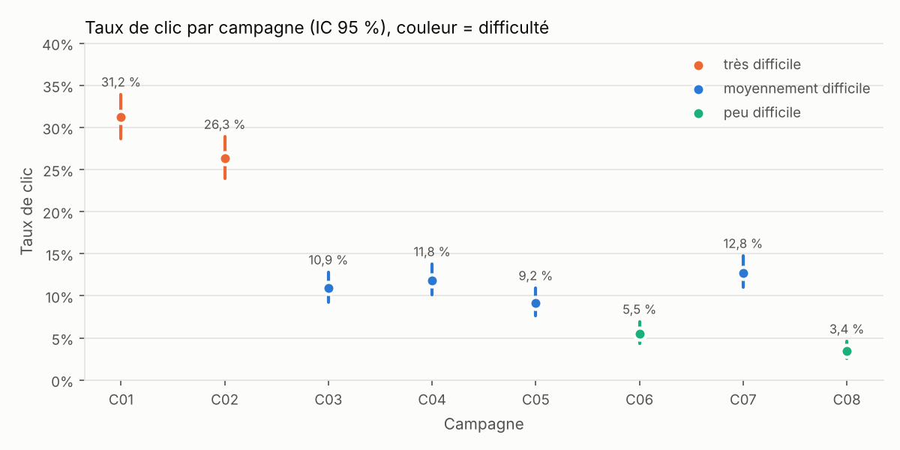

# Phishing Campaign Analyzer

**Analyser une campagne de phishing d'entraînement comme le ferait un
chercheur : ce qui a vraiment changé, ce qui n'a pas changé, et quoi faire
ensuite.**

Une équipe sécurité qui lance des campagnes de phishing d'entraînement doit
ensuite répondre au RSSI : « Est-ce que ça marche ? » La réponse habituelle est
un taux de clic qui baisse, présenté comme une victoire. Ce projet montre
pourquoi cette lecture est souvent **fausse**, et produit à la place un rapport
statistiquement solide, bilingue, respectueux des employés, avec des actions
correctives chiffrées.

> Projet défensif. Il n'écrit **aucun e-mail de phishing** : il analyse des
> résultats de campagnes (clics, saisies, signalements) et produit les pages
> de sensibilisation vues après l'exercice.

---

## Le résultat principal en une figure



Le taux de clic passe de **22,8 %** (3 premières campagnes) à **7,2 %** (3
dernières) : une baisse « significative » (p < 0,001). Conclusion tentante :
le programme fonctionne. Mais les couleurs racontent autre chose : les
premières campagnes étaient **très difficiles**, les dernières **faciles**
(NIST Phish Scale). **À difficulté égale, aucune baisse n'est démontrée**
(OR 0,97 par campagne, IC 95 % 0,80–1,18). En revanche, le **signalement
progresse réellement**, même à difficulté égale (OR 1,10 par campagne,
IC 1,07–1,12).

## Quatre études derrière chaque choix

| Étude | Ce qu'elle établit | Ce que le projet en fait |
|---|---|---|
| **Dawkins & Jacobs**, *NIST Phish Scale User Guide*, NIST TN 2276, 2023 | Une méthode pour noter la difficulté d'un e-mail : nombre d'indices visibles × alignement du prétexte avec le travail. | Chaque campagne est notée ([`phishscale.py`](src/phishcamp/phishscale.py)) ; aucune comparaison entre campagnes sans cette note. |
| **Ho et al.**, *Understanding the Efficacy of Phishing Training in Practice*, IEEE S&P 2025 (19 789 employés, 8 mois) | Le taux d'échec dépend surtout du leurre (1,8 % à 30,8 %) ; la formation réduit l'échec d'à peine 1,7 point ; 56 % des employés échouent au moins une fois. | Analyse à difficulté égale ; effet de la formation mesuré contre un groupe témoin **avec sa puissance statistique** ; message « cliquer est la norme ». |
| **Lain et al.**, *Phishing in Organizations*, IEEE S&P 2022 (14 733 employés, 15 mois) | Les signalements arrivent vite et révèlent de vraies campagnes ; le retour positif encourage à signaler. | Le **signalement** est un indicateur de premier rang : taux, vitesse (< 5 min, < 30 min), signalements par clic. |
| **Zeger, Liang & Albert**, *Biometrics*, 1988 | Un modèle sans effet individuel estime un effet « moyen de population », plus proche de 1. | La validation compare l'estimation à la bonne cible (OR individuel 0,905 → moyen 0,916). |

Détails : [`docs/research.md`](docs/research.md).

## Ce que produit l'outil

- **Rapport au RSSI**, en [français](report/report_fr.md) et en [anglais](report/report_en.md) :
  résultats par campagne avec intervalles de confiance, piège du taux brut,
  analyse à difficulté égale, effet de la formation, résultats par service.
- **Actions correctives priorisées** (P1–P3), chacune justifiée par un chiffre :
  ne pas annoncer un faux progrès, ne pas étendre une formation sans effet
  démontré, déployer une MFA résistante au phishing, outiller le signalement.
- **Pages de sensibilisation** FR/EN pour chaque campagne ([`i18n/`](i18n/)) :
  les indices de cet e-mail précis, le bon réflexe, sans culpabiliser.
- **Figures** : clic par campagne et difficulté, signalement, délai de signalement.

## La méthode a été vérifiée

Une analyse statistique peut se tromper avec assurance. Ici, les données sont
simulées à partir de paramètres connus (calés sur les études), donc on peut
vérifier que l'analyse **retrouve la vérité** (200 simulations,
[`scripts/validate.py`](scripts/validate.py)) :

| Contrôle | Résultat | Attendu |
|---|---|---|
| Le taux brut début/fin conclut à un progrès alors qu'il n'y en a aucun | **100 %** des simulations | c'est le piège |
| Tendance « à difficulté égale », modèle par employé | 27,5 % de faux positifs | 5 % : **ce modèle est faux** |
| Tendance « à difficulté égale », test au niveau campagne (retenu) | **6,5 %** de faux positifs | ≈ 5 % |
| Effet de la formation : estimation moyenne (vrai OR moyen 0,916) | 0,913 | ≈ 0,916 |
| Couverture de l'IC 95 % de la formation, erreurs robustes par employé | **93,5 %** | 95 % |
| Même chose sans correction par employé | 87 % | IC trop étroits |
| Puissance pour détecter l'effet de la formation (1 200 employés) | 19,5 % | trop faible : à dire avant l'expérience |
| Puissance pour détecter la hausse du signalement | 96,5 % | — |

Deux erreurs classiques ont été trouvées **et corrigées** grâce à cette
validation : traiter les 8 réponses d'un employé comme indépendantes, et
tester une tendance par employé alors qu'il n'y a que 8 campagnes.

## Confidentialité

Aucun résultat individuel n'est publié, les identifiants sont pseudonymisés,
les groupes de moins de 10 personnes sont masqués, et les recommandations
visent des processus, jamais des personnes. Voir [`docs/ethics.md`](docs/ethics.md).

## Lancer le projet

```bash
git clone https://github.com/FatimaZahraRH/Phishing-Campaign-Analyzer.git
cd Phishing-Campaign-Analyzer
python3 -m venv venv && source venv/bin/activate
pip install -r requirements.txt

python -m pytest -q              # 15 tests
python scripts/analyze.py        # rapport FR/EN, figures, pages de sensibilisation
python scripts/validate.py       # 200 simulations : l'analyse retrouve-t-elle la vérité ?
python scripts/simulate.py       # (optionnel) régénérer les données
```

Pour analyser vos propres campagnes : décrire chaque campagne dans
`campaigns/campaigns.json` (indices et prétexte, grille NIST) et fournir
`data/employees.csv` et `data/events.csv` au même format.

## Organisation

```
campaigns/campaigns.json   8 campagnes : thème FR/EN, indices, notes de prétexte (NIST)
config/simulation.json     paramètres de simulation, chacun relié à une étude
src/phishcamp/
  phishscale.py            NIST Phish Scale (indices × prétexte -> difficulté)
  simulate.py              génération des résultats
  stats.py                 Wilson, régression logistique robuste par grappe,
                           tendance au niveau campagne, taille d'échantillon
  analyze.py               indicateurs, modèles, services, répétition
  actions.py               actions correctives FR/EN
  report.py                rapport FR/EN + figures
  i18n.py                  pages de sensibilisation FR/EN
scripts/                   simulate.py, analyze.py, validate.py
report/                    rapports, figures, summary.json, validation.json
i18n/                      16 pages (8 campagnes × 2 langues)
docs/                      research.md, simulation.md, ethics.md
tests/                     15 tests
```

## Limites assumées

- **Données simulées.** Aucun jeu de résultats de campagnes réelles n'est
  public (ce sont des données personnelles). Le modèle et ses paramètres sont
  documentés dans [`docs/simulation.md`](docs/simulation.md) ; l'analyse, elle,
  ne lit que les événements.
- **Notes Phish Scale attribuées par moi**, sur des campagnes décrites (pas
  d'e-mails rédigés). En pratique, deux personnes devraient noter séparément.
- **8 campagnes, c'est peu** pour une tendance : l'intervalle du clic à
  difficulté égale (0,80–1,18) est large. L'outil le dit au lieu de trancher.

## Références

- S. Dawkins, J. Jacobs, *NIST Phish Scale User Guide*, NIST TN 2276, 2023. [PDF](https://nvlpubs.nist.gov/nistpubs/TechnicalNotes/NIST.TN.2276.pdf)
- G. Ho, A. Mirian, E. Luo, K. Tong, E. Lee, L. Liu, C. A. Longhurst, C. Dameff, S. Savage, G. M. Voelker, *Understanding the Efficacy of Phishing Training in Practice*, IEEE S&P 2025. [PDF](https://sysnet.ucsd.edu/~voelker/pubs/phishtrain-oakland25.pdf)
- D. Lain, K. Kostiainen, S. Čapkun, *Phishing in Organizations: Findings from a Large-Scale and Long-Term Study*, IEEE S&P 2022. [arXiv:2112.07498](https://arxiv.org/abs/2112.07498)
- S. L. Zeger, K.-Y. Liang, P. S. Albert, *Models for Longitudinal Data: A Generalized Estimating Equation Approach*, Biometrics 44(4), 1988.

Projet lié : [Phishing Report Triage](https://github.com/FatimaZahraRH/Phishing_Report_Triage),
qui traite les signalements que ce programme encourage.
