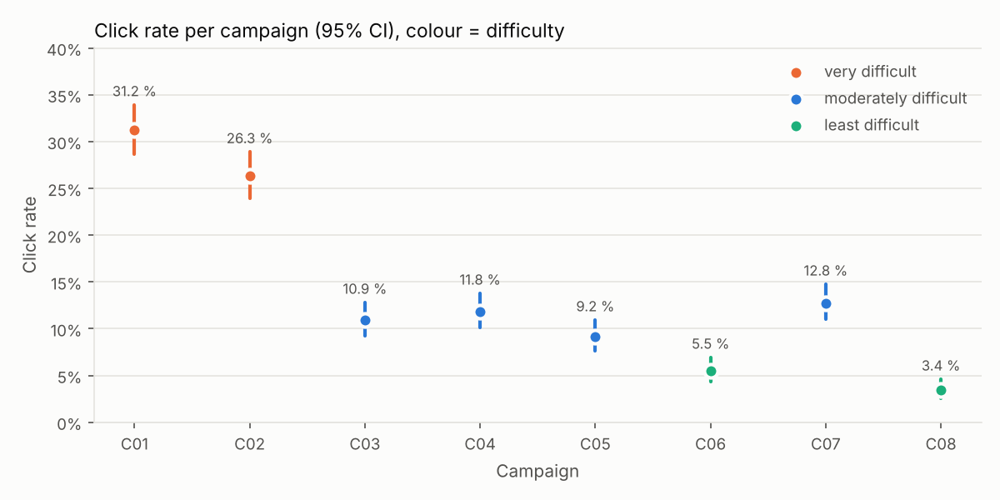
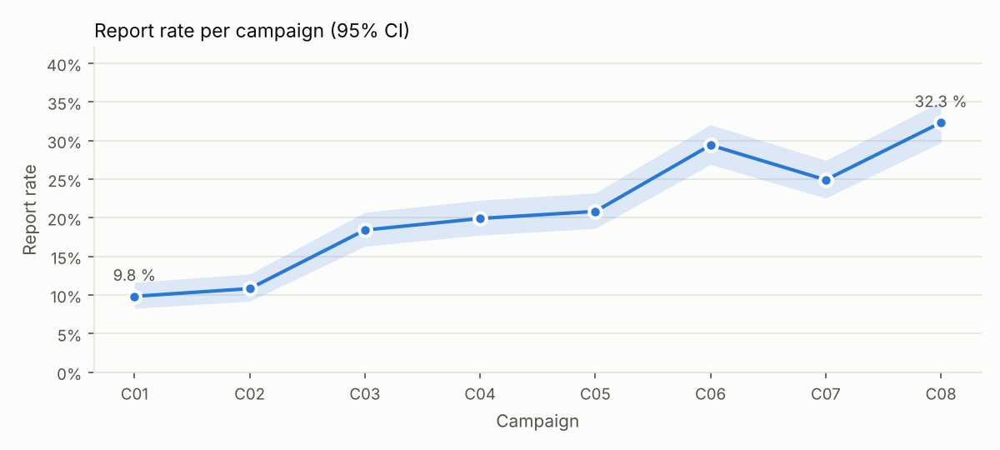
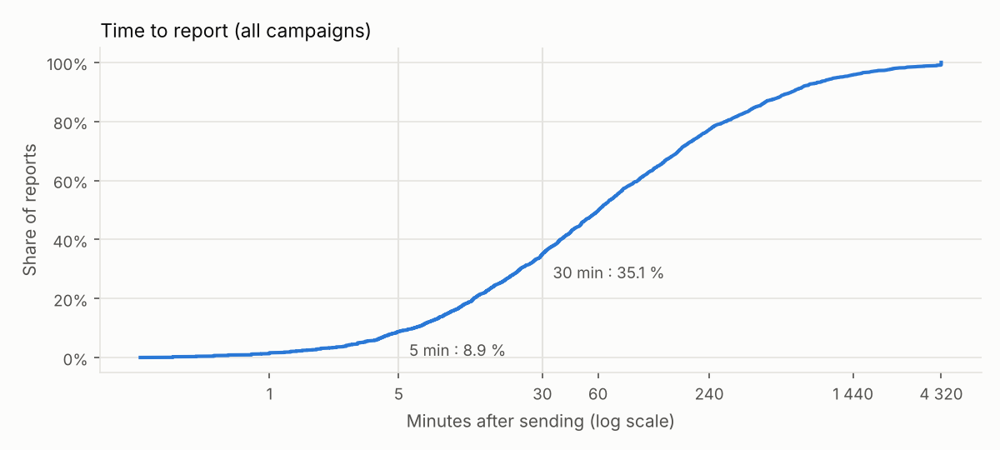

# Phishing simulation campaign analysis

*Report to the CISO. Simulated data (see docs/simulation.md); no individual result is published.*

## Key takeaways

- The raw click rate drops from **22.8%** to **7.2%**, but **at equal difficulty, no drop is demonstrated** (OR per campaign 0.97, 95% CI 0.80–1.18).
- Post-click training has **no demonstrated effect** (OR 0.93, CI 0.79–1.10); the sample is too small to decide (4032 observations per group, at least 5272 needed).
- **Reporting is genuinely improving**: from 9.8% to 32.3%, **even at equal difficulty** (OR 1.10 per campaign, CI 1.07–1.12).
- **61.1%** of employees clicked at least once: defence must be technical as much as human.

## Corrective actions

1. **P1** — Do not report progress. The raw click rate drops from 22.8% to 7.2%, but at equal difficulty (NIST Phish Scale) no drop is demonstrated (OR per campaign 0.97, 95% CI 0.80–1.18). The drop is explained by easier lures. Always report rates alongside each campaign's difficulty.
2. **P2** — Post-click training shows no demonstrated effect (OR 0.93, 95% CI 0.79–1.10). With 4032 observations per group, at least 5272 would be needed to detect the effect reported by Ho et al. (−1.7 points). Do not scale it up on this basis; favour interactive training: in that study it is the only kind associated with a benefit, once completed.
3. **P2** — Very difficult lures catch up to 31.2% of employees (C01), and 6.3% of recipients entered credentials across all campaigns. Training will not be enough: roll out phishing-resistant MFA (FIDO2 keys / passkeys), privileged accounts first, and add an 'external sender' banner.
4. **P3** — Reporting is improving (9.8% → 32.3%), and not only because lures got easier (OR 1.10 per campaign at equal difficulty). 36.6% of reports arrive within 30 minutes. Keep replying to every reporter (positive feedback) and connect the reporting mailbox to automated triage, so these human alerts help block real campaigns.
5. **P3** — 61.1% of employees clicked at least once in 8 campaigns: clicking is the norm, not the exception. Communicate without blame, and never publish individual results.

## Results per campaign

| Campaign | Month | Theme | Difficulty (Phish Scale) | Click | Credentials entered | Report | Reports / click | Reports < 30 min |
|---|---|---|---|---|---|---|---|---|
| C01 | 2026-02 | Updated leave policy | very difficult (5 cues, premise 24) | 31.2% [28.7–33.9] | 13.8% | 9.8% [8.3–11.6] | 0.3 | 36.4% |
| C02 | 2026-03 | Shared document awaiting review | very difficult (6 cues, premise 20) | 26.3% [23.9–28.9] | 13.2% | 10.8% [9.2–12.7] | 0.4 | 32.3% |
| C03 | 2026-04 | Company health plan enrolment | moderately difficult (10 cues, premise 16) | 10.9% [9.3–12.8] | 4.6% | 18.4% [16.3–20.7] | 1.7 | 37.1% |
| C04 | 2026-05 | E-signature request for an amendment | moderately difficult (11 cues, premise 14) | 11.8% [10.1–13.8] | 4.7% | 19.9% [17.8–22.3] | 1.7 | 31.4% |
| C05 | 2026-06 | Building evacuation drill | moderately difficult (11 cues, premise 14) | 9.2% [7.7–10.9] | 4.3% | 20.8% [18.6–23.2] | 2.3 | 31.2% |
| C06 | 2026-07 | Parcel awaiting delivery | least difficult (16 cues, premise 6) | 5.5% [4.3–6.9] | 2.4% | 29.4% [26.9–32.1] | 5.3 | 36.3% |
| C07 | 2026-08 | Mailbox security alert | moderately difficult (12 cues, premise 14) | 12.8% [11.0–14.8] | 6.0% | 24.9% [22.6–27.4] | 2.0 | 37.5% |
| C08 | 2026-09 | Gift card prize | least difficult (18 cues, premise 0) | 3.4% [2.5–4.6] | 1.2% | 32.3% [29.7–35.0] | 9.5 | 36.6% |

## The raw-rate trap

Comparing the first 3 campaigns (C01, C02, C03) with the last 3 (C06, C07, C08) shows a dramatic, 'significant' drop: 22.8% → 7.2% (p < 0.001). Naive conclusion: the programme works. But the first campaigns were **very difficult** and the last ones **easier** (NIST Phish Scale). Ho et al. observe the same over 19,789 employees: failure depends mostly on the lure (1.8% to 30.8%).

## Analysis at equal difficulty

Per-employee logistic regression: click ~ campaign (fixed effects) + training + department. Training and department are compared within each campaign. Employee-clustered robust standard errors (each employee appears 8 times).

| Variable | OR | 95% CI | p |
|---|---|---|---|
| training | 0.93 | 0.79–1.10 | 0.411 |
| department: Audit | 0.94 | 0.76–1.16 | 0.557 |
| department: Management | 1.23 | 0.78–1.92 | 0.372 |
| department: Finance | 1.17 | 0.92–1.49 | 0.198 |
| department: IT | 0.84 | 0.63–1.12 | 0.234 |
| department: Legal | 1.06 | 0.78–1.43 | 0.714 |
| department: HR | 1.08 | 0.80–1.46 | 0.613 |

Reference department: Consulting

**Trends, tested at campaign level** (logit of rate ~ difficulty + campaign number, t-test with 4 degrees of freedom). Each campaign has its own noise: with 8 campaigns, their number, not the number of employees, limits precision. A per-employee model wrongly finds a trend in ≈ 28% of cases (see validation).

- Effect of difficulty on clicks: moderate OR 2.6, very difficult OR 7.5 (vs least difficult)
- Click trend: OR 0.97 per campaign, 95% CI 0.80–1.18, p = 0.689
- Report trend: OR 1.10 per campaign, 95% CI 1.07–1.12, p < 0.001

## Does post-click training work?

After the 1st campaign, half of the employees (randomly assigned) see a training page after a click. Trained group click rate: 11.1% [9.9–12.2]; control: 11.7% [10.6–12.9]. Difference -0.7 point(s), 95% CI -2.3 to +0.9, p = 0.41.

**Power.** Detecting the effect observed by Ho et al. (−1.7 points) would need **at least 5272 observations per group** (80% power, assuming independent answers; more in practice, since each employee answers 8 times); we have 4032. An organisation this size cannot prove that such training works: say so before running the experiment, not after.

## By department

Groups under 10 people are hidden. Employee-clustered intervals (8 answers from one person are not 8 people).

| Department | Headcount | Click | Report |
|---|---|---|---|
| Audit | 297 | 13.2% [11.4–14.9] | 20.8% [19.2–22.4] |
| Consulting | 416 | 13.8% [12.4–15.3] | 20.3% [19.0–21.7] |
| Management | 44 | 16.2% [10.8–21.6] | 22.7% [18.2–27.3] |
| Finance | 150 | 15.7% [13.2–18.1] | 20.8% [18.5–23.2] |
| IT | 122 | 12.0% [9.5–14.5] | 20.1% [17.3–22.9] |
| Legal | 90 | 14.4% [11.3–17.6] | 22.6% [19.7–25.5] |
| HR | 81 | 14.7% [11.5–17.8] | 21.3% [18.5–24.1] |

## How many employees click?

Employees who clicked 0 / 1 / 2 / 3+ times over 8 campaigns: 467 / 373 / 202 / 158. Employees with 3+ clicks account for 41.8% of clicks: private, individual support can be considered, but never a circulated list of names.
