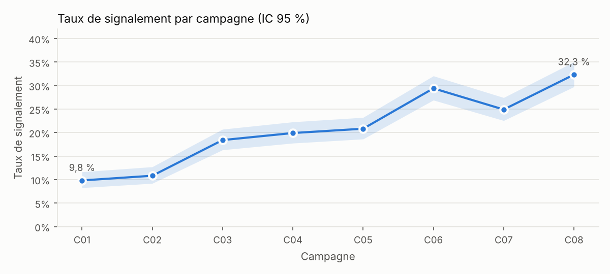
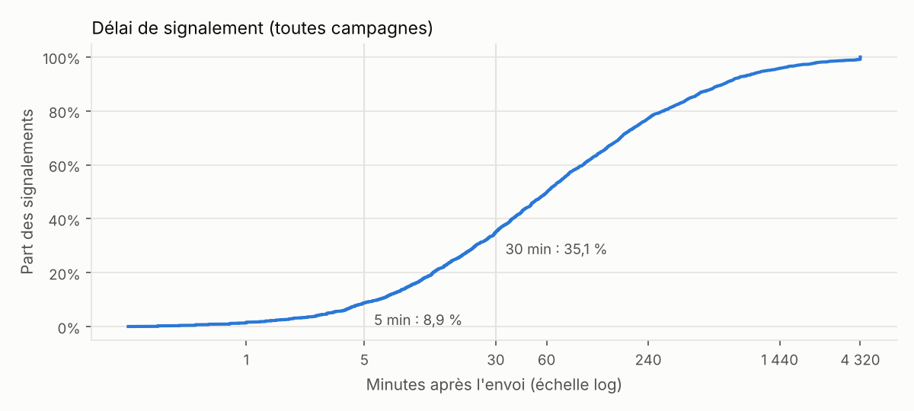

# Analyse des campagnes de phishing d'entraînement

*Rapport au RSSI. Données simulées (voir docs/simulation.md) ; aucun résultat individuel n'est publié.*

## Ce qu'il faut retenir

- Le taux de clic brut baisse de **22,8 %** à **7,2 %**, mais **à difficulté égale, aucune baisse n'est démontrée** (OR par campagne 0,97, IC 95 % 0,80–1,18).
- La formation après clic n'a **pas d'effet démontré** (OR 0,93, IC 0,79–1,10) ; l'échantillon est trop petit pour trancher (4032 observations par groupe, au moins 5272 nécessaires).
- Le **signalement progresse vraiment** : de 9,8 % à 32,3 %, et **même à difficulté égale** (OR 1,10 par campagne, IC 1,07–1,12).
- **61,1 %** des employés ont cliqué au moins une fois : la défense doit être technique autant qu'humaine.

## Actions correctives

1. **P1** — Ne pas annoncer de progrès. Le taux de clic brut passe de 22,8 % à 7,2 %, mais à difficulté égale (NIST Phish Scale) aucune baisse n'est démontrée (OR par campagne 0,97, IC 95 % 0,80–1,18). La baisse s'explique par des leurres plus faciles. Toujours publier les taux avec la difficulté de chaque campagne.
2. **P2** — La formation après clic n'a pas d'effet démontré (OR 0,93, IC 95 % 0,79–1,10). Avec 4032 observations par groupe, il en faudrait au moins 5272 pour détecter l'effet rapporté par Ho et al. (−1,7 point). Ne pas étendre le dispositif sur cette base ; privilégier la formation interactive : dans cette étude, c'est la seule associée à un bénéfice, une fois suivie jusqu'au bout.
3. **P2** — Les leurres très difficiles piègent jusqu'à 31,2 % des employés (C01), et 6,3 % des destinataires ont saisi des identifiants sur l'ensemble des campagnes. La formation ne suffira pas : généraliser une MFA résistante au phishing (clés FIDO2 / passkeys) en commençant par les comptes à privilèges, et ajouter un bandeau « expéditeur externe ».
4. **P3** — Le signalement progresse (9,8 % → 32,3 %), et pas seulement parce que les leurres étaient plus faciles (OR 1,10 par campagne à difficulté égale). 36,6 % des signalements arrivent en moins de 30 minutes. Continuer à répondre à chaque signaleur (retour positif) et brancher la boîte « signalements » sur un triage automatique, pour que ces alertes humaines servent à bloquer les vraies campagnes.
5. **P3** — 61,1 % des employés ont cliqué au moins une fois en 8 campagnes : cliquer est la norme, pas l'exception. Communiquer sans culpabiliser, et ne jamais publier de résultats individuels.

## Résultats par campagne

| Campagne | Mois | Thème | Difficulté (Phish Scale) | Clic | Saisie d'identifiants | Signalement | Signalements / clic | Signalements < 30 min |
|---|---|---|---|---|---|---|---|---|
| C01 | 2026-02 | Mise à jour de la politique de congés | très difficile (5 indices, prétexte 24) | 31,2 % [28,7–33,9] | 13,8 % | 9,8 % [8,3–11,6] | 0,3 | 36,4 % |
| C02 | 2026-03 | Document partagé en attente de lecture | très difficile (6 indices, prétexte 20) | 26,3 % [23,9–28,9] | 13,2 % | 10,8 % [9,2–12,7] | 0,4 | 32,3 % |
| C03 | 2026-04 | Inscription à la mutuelle d'entreprise | moyennement difficile (10 indices, prétexte 16) | 10,9 % [9,3–12,8] | 4,6 % | 18,4 % [16,3–20,7] | 1,7 | 37,1 % |
| C04 | 2026-05 | Signature électronique d'un avenant | moyennement difficile (11 indices, prétexte 14) | 11,8 % [10,1–13,8] | 4,7 % | 19,9 % [17,8–22,3] | 1,7 | 31,4 % |
| C05 | 2026-06 | Exercice d'évacuation du bâtiment | moyennement difficile (11 indices, prétexte 14) | 9,2 % [7,7–10,9] | 4,3 % | 20,8 % [18,6–23,2] | 2,3 | 31,2 % |
| C06 | 2026-07 | Colis en attente de livraison | peu difficile (16 indices, prétexte 6) | 5,5 % [4,3–6,9] | 2,4 % | 29,4 % [26,9–32,1] | 5,3 | 36,3 % |
| C07 | 2026-08 | Alerte de sécurité sur le compte de messagerie | moyennement difficile (12 indices, prétexte 14) | 12,8 % [11,0–14,8] | 6,0 % | 24,9 % [22,6–27,4] | 2,0 | 37,5 % |
| C08 | 2026-09 | Gain d'une carte cadeau | peu difficile (18 indices, prétexte 0) | 3,4 % [2,5–4,6] | 1,2 % | 32,3 % [29,7–35,0] | 9,5 | 36,6 % |

## Le piège du taux brut

Comparer les 3 premières campagnes (C01, C02, C03) aux 3 dernières (C06, C07, C08) donne une baisse spectaculaire et « significative » : 22,8 % → 7,2 % (p < 0,001). Conclusion naïve : le programme fonctionne. Mais les premières campagnes étaient **très difficiles** et les dernières **plus faciles** (NIST Phish Scale). Ho et al. observent la même chose sur 19 789 employés : le taux d'échec dépend surtout du leurre (de 1,8 % à 30,8 %).

## Analyse à difficulté égale

Régression logistique par employé : clic ~ campagne (effets fixes) + formation + service. Formation et service sont comparés à l'intérieur de chaque campagne. Erreurs standard robustes par employé (chaque employé apparaît 8 fois).

| Variable | OR | IC 95 % | p |
|---|---|---|---|
| formation | 0,93 | 0,79–1,10 | 0,411 |
| service : Audit | 0,94 | 0,76–1,16 | 0,557 |
| service : Direction | 1,23 | 0,78–1,92 | 0,372 |
| service : Finance | 1,17 | 0,92–1,49 | 0,198 |
| service : IT | 0,84 | 0,63–1,12 | 0,234 |
| service : Juridique | 1,06 | 0,78–1,43 | 0,714 |
| service : RH | 1,08 | 0,80–1,46 | 0,613 |

Service de référence : Conseil

**Tendances, testées au niveau campagne** (logit du taux ~ difficulté + n° de campagne, test t à 4 degrés de liberté). Chaque campagne a sa part d'aléa : avec 8 campagnes, c'est leur nombre, pas celui des employés, qui limite la précision. Un modèle par employé conclut à tort à une tendance dans ≈ 28 % des cas (voir la validation).

- Effet de la difficulté sur le clic : moyenne OR 2,6, très difficile OR 7,5 (contre peu difficile)
- Tendance du clic : OR 0,97 par campagne, IC 95 % 0,80–1,18, p = 0,689
- Tendance du signalement : OR 1,10 par campagne, IC 95 % 1,07–1,12, p < 0,001

## La formation après clic marche-t-elle ?

Après la 1re campagne, la moitié des employés (tirée au sort) voit une page de formation après un clic. Clic du groupe formé : 11,1 % [9,9–12,2] ; groupe témoin : 11,7 % [10,6–12,9]. Écart -0,7 point(s), IC 95 % -2,3 à +0,9, p = 0,41.

**Puissance.** Pour détecter l'effet observé par Ho et al. (−1,7 point), il faudrait **au moins 5272 observations par groupe** (puissance 80 %, en supposant des réponses indépendantes ; davantage en réalité, puisque chaque employé répond 8 fois) ; on en a 4032. Une organisation de cette taille ne peut pas prouver qu'une formation de ce type marche : il faut le dire avant de lancer l'expérience, pas après.

## Par service

Groupes de moins de 10 personnes masqués. Intervalles robustes par employé (8 réponses d'une même personne ne valent pas 8 personnes).

| Service | Effectif | Clic | Signalement |
|---|---|---|---|
| Audit | 297 | 13,2 % [11,4–14,9] | 20,8 % [19,2–22,4] |
| Conseil | 416 | 13,8 % [12,4–15,3] | 20,3 % [19,0–21,7] |
| Direction | 44 | 16,2 % [10,8–21,6] | 22,7 % [18,2–27,3] |
| Finance | 150 | 15,7 % [13,2–18,1] | 20,8 % [18,5–23,2] |
| IT | 122 | 12,0 % [9,5–14,5] | 20,1 % [17,3–22,9] |
| Juridique | 90 | 14,4 % [11,3–17,6] | 22,6 % [19,7–25,5] |
| RH | 81 | 14,7 % [11,5–17,8] | 21,3 % [18,5–24,1] |

## Combien d'employés cliquent ?

Employés ayant cliqué 0 / 1 / 2 / 3+ fois sur 8 campagnes : 467 / 373 / 202 / 158. Les employés à 3 clics ou plus représentent 41,8 % des clics : un accompagnement individuel, proposé en privé, peut se discuter, mais jamais de liste nominative diffusée.
